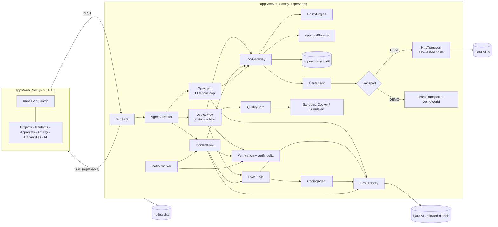
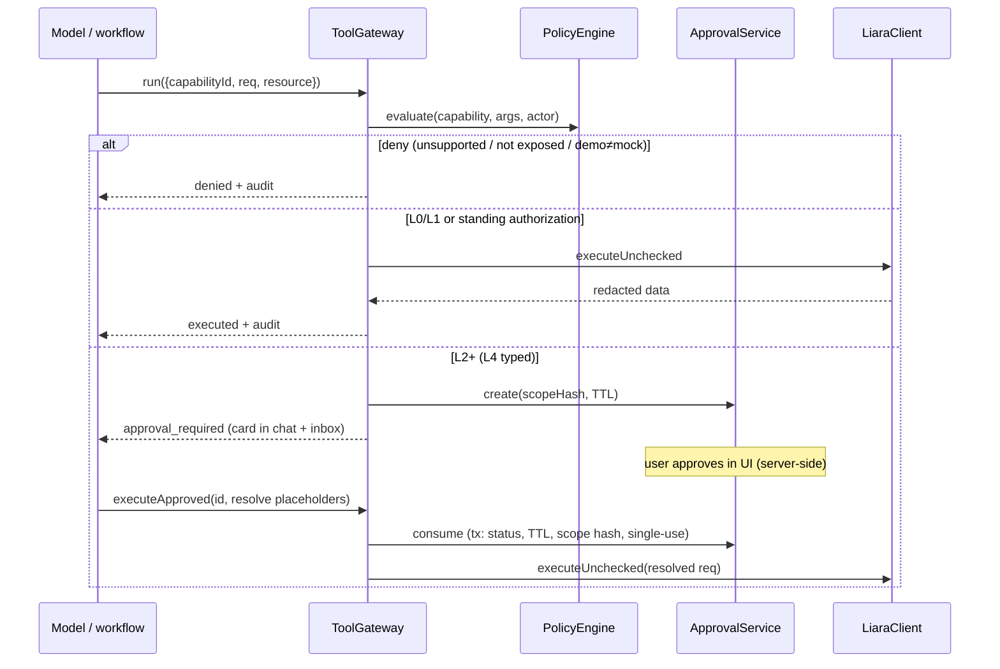

# Architecture

## Components



## Deploy flow (DeployGraph)

```mermaid
stateDiagram-v2
  [*] --> source: ask card
  source --> analyze: git / zip / sample
  analyze --> platform --> stage --> users --> appName
  appName --> database: new app & DB detected
  appName --> env: existing app
  database --> network --> env --> plan
  plan --> gate
  gate --> invoice: PASS / WARN
  gate --> rca: FAIL
  rca --> patch: code defect (≤ MAX attempts)
  rca --> env: CONFIG_ENV
  patch --> gate: applied to deploy copy
  rca --> acceptIssues: pre-existing / attempts exhausted
  acceptIssues --> invoice: user accepts risk (audited)
  invoice --> execute: approvals approved (server-side)
  execute --> poll: createApp → createDatabase → updateEnvs → upload → release
  poll --> verify: READY
  poll --> deployFailed: FAILED/TIMEOUT
  deployFailed --> redeployApproval: env fix / patch
  verify --> patrolOffer: healthy/warning
  verify --> [*]: unhealthy (no success claimed)
  patrolOffer --> [*]
```

Every transition is persisted in `runs.state_json` before side effects; answers/approvals resume the run.
Interrupted runs are marked on boot (`Agent.recover`).

## Tool execution boundary



## Model routing
`config/models.yaml` maps roles → primary + fallbacks (only allowed IDs). The gateway skips models whose probe failed or
that the catalog says lack a needed parameter (e.g. `tools`), retries transient errors with backoff, escalates after two
failed repair attempts, validates structured output with zod, records tokens/latency/`total_cost_toman`, and enforces
daily/per-run Toman budgets.

## Why not LangGraph/Python
The owner allowed any architecture and preferred TypeScript. The same guarantees (typed state, checkpoints, resumable
human-in-the-loop interrupts) are implemented as explicit state machines persisted in SQLite, which keeps
policy/approval semantics in deterministic code and avoids a second runtime.
